# GitHub World Map

A Python project that visualizes estimated commit activity across public GitHub repositories using a world map and randomly distributed green markers.



## Overview

GitHub World Map uses the GitHub REST API to retrieve public repositories for a configured GitHub username, estimate their commit counts, and represent the combined total as green dots on a world map.

The geographic coordinates are generated from predefined latitude and longitude ranges. The markers are illustrative: **they do not represent actual commit locations or real cities**.

## Features

- Retrieves public repository information through the GitHub REST API.
- Estimates repository commit counts using API pagination metadata.
- Generates geographic sample coordinates with Python.
- Renders green markers on an SVG world map.
- Produces repeatable marker placement when the estimated commit total remains unchanged.
- Supports optional GitHub API authentication through `GH_TOKEN`.

## Project Structure

```text
github-world-map/
├── assets/
│   ├── world.svg
│   └── world-map.svg
├── scripts/
│   ├── cities.py
│   └── generate_map.py
├── .gitignore
└── README.md
```

## Requirements

- Python 3
- Internet access
- A GitHub username configured in `scripts/generate_map.py`

A GitHub personal access token can optionally be provided through the `GH_TOKEN` environment variable to authenticate API requests.

## Getting Started

Clone the repository:

```bash
git clone https://github.com/Hammadmustafagundroo/github-world-map.git
cd github-world-map
```

Generate the map:

```bash
python3 scripts/generate_map.py
```

The generated visualization is saved to `assets/world-map.svg`.

## Limitations

- Commit totals are estimates derived from GitHub API pagination metadata; they are not guaranteed exact totals.
- The current implementation retrieves at most 100 public repositories.
- Geographic points are synthetic and can appear over oceans.
- The map does not show actual contribution locations or individual commit histories.

## License

This project is licensed under the [MIT License](LICENSE).
